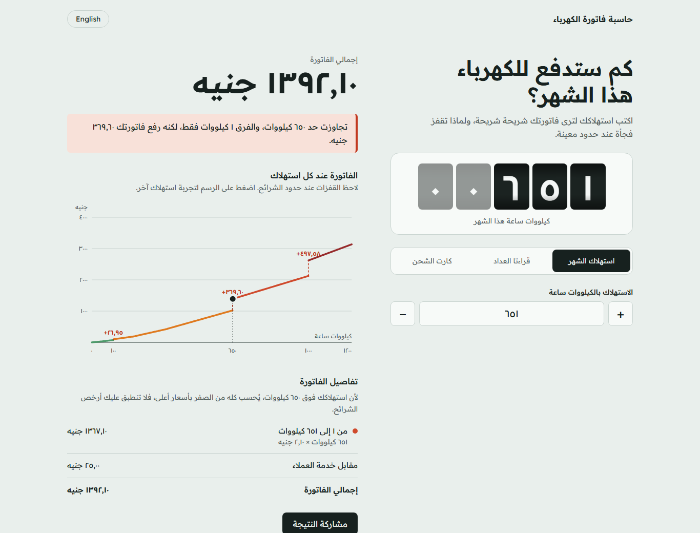
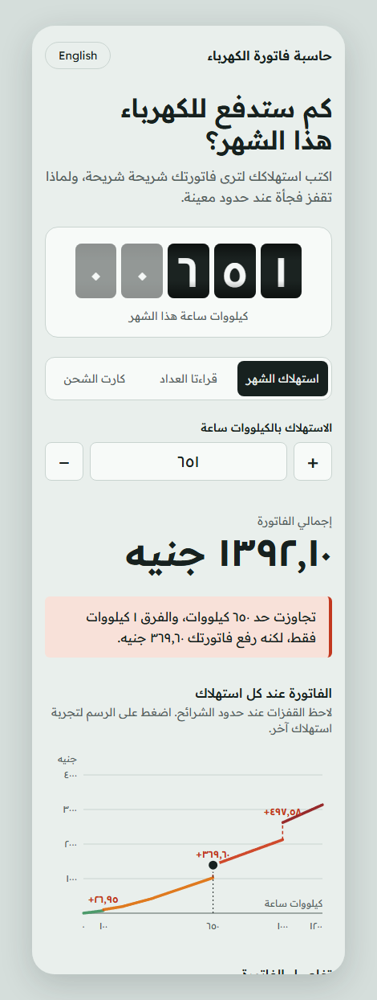

# Egyptian electricity bill calculator

**حاسبة فاتورة الكهرباء المنزلية في مصر**: اعرف فاتورتك شريحة شريحة، ولماذا تقفز فجأة عند ١٠٠ و٦٥٠ و١٠٠٠ كيلووات.

**Live:** https://bassamradwan.github.io/egypt-electricity-bill/

<p>
  
  
</p>

## Why

Egyptian home electricity is priced in tiers, but not the way most people expect. Above certain limits the **whole** month is recounted from zero at a higher price. So **650 kWh costs EGP 1,022.50, and 651 kWh costs EGP 1,392.10**: one kWh adds EGP 369.60.

This page shows the bill line by line and makes those cliffs visible, so people understand their bill and know how far they are from the next jump.

## Features

- **Three ways in:** the month's consumption, the meter's previous and current readings, or a prepaid card amount ("how many kWh does EGP 500 buy this month?").
- **The bill line by line:** kWh in each tier × its price, the customer service fee, the total.
- **Cliff warnings:** "you went 1 kWh over the 650 limit and it added EGP 369.60", or "10 kWh left before the limit".
- **The bill chart:** the bill at every consumption level, with the jumps marked. Tap or drag on it to try another amount.
- **Meter-style counter** that rolls to the new number.
- **Arabic first** (right to left, Arabic-Indic digits), with an English version. Inputs accept ٠-٩, ۰-۹ and 0-9.
- **Shareable results:** the address always holds the inputs (`?kwh=651`, `?budget=500`, `&lang=en`).
- Works on phones, light and dark mode, keyboard focus, reduced motion.

## The tariff

Residential prices from the April 2026 consumption month, as published by the regulator, [EgyptERA](https://egyptera.org/en/TarrifApril2026.aspx) (checked on 11 November 2026):

| Monthly consumption | How it's charged |
|---|---|
| up to 100 kWh | 1-50 at 68 pt, 51-100 at 78 pt |
| 101 to 650 kWh | **from zero:** 1-200 at 95 pt, 201-350 at 155 pt, 351-650 at 195 pt |
| 651 to 1000 kWh | **all of it** at 210 pt |
| above 1000 kWh | **all of it** at 258 pt |

Customer service fee: EGP 1, 2, 6, 11, 15, 25 or 40 depending on consumption; EGP 9 for zero consumption.

Not included: local charges some bodies add to the bill (for example the cleaning fee).

## Design decisions

- **Money in piasters.** Every amount is a whole number of piasters (1 EGP = 100 pt), so sums never hit floating-point errors like `0.1 + 0.2 = 0.30000000000000004`.
- **The tariff is data, not code.** [`src/lib/tariff.ts`](src/lib/tariff.ts) describes groups of bands; one function, `calculateBill`, works for any tariff with that shape. A new tariff is a new object, not new logic.
- **Prepaid card: binary search.** The bill grows with every extra kWh from 1 kWh up (a test checks every value up to 5000), so `maxKwhForBudget` finds the answer in about 20 steps. 0 kWh is a special case: its fee (EGP 9) is higher than the bill for 1 kWh.
- **A static site.** `output: "export"` builds plain HTML, CSS and JS, hosted free on GitHub Pages. No server, no database: results are shared through the address.
- **No hydration mismatch.** The address and the saved language only exist in the browser, so they are read with `useSyncExternalStore`: the prebuilt HTML and the first browser render always match.
- **The chart is plain SVG,** drawn at its container's real width (measured with `ResizeObserver`), so the labels stay readable on a phone. No chart library.
- **No thousands separator in Arabic.** In many fonts `٬` (thousands) and `٫` (decimal) look alike, so `١٬٣٩٢٫١٠` reads as three groups; the page shows `١٣٩٢٫١٠`.

## Tests

```bash
npm test
```

74 tests (Vitest), mainly on the calculation in [`src/lib/bill.ts`](src/lib/bill.ts): the total at every tier boundary (0, 1, 50, 51, 100, 101, 200, 201, 350, 351, 650, 651, 1000, 1001 kWh), the bill lines, the cliff warnings, the prepaid card, meter readings, and number input in three digit systems. Every expected value is worked out by hand from the official table.

CI runs the types, lint and tests on every push, then builds and deploys the site.

## Run it

```bash
npm install
npm run dev        # http://localhost:3000
npm test
npm run build      # static site in out/
```

## Updating the tariff

1. Add a new `Tariff` object in `src/lib/tariff.ts` with the new prices, `validFrom` and `checkedOn`, and point `CURRENT_TARIFF` to it.
2. Update the expected values in `src/lib/bill.test.ts` (worked out by hand from the new table) and run `npm test`.
3. Update the source note in `src/lib/i18n.ts`.

## Built with

Next.js 16 (App Router, static export), React 19, TypeScript, Tailwind CSS 4, Vitest.
